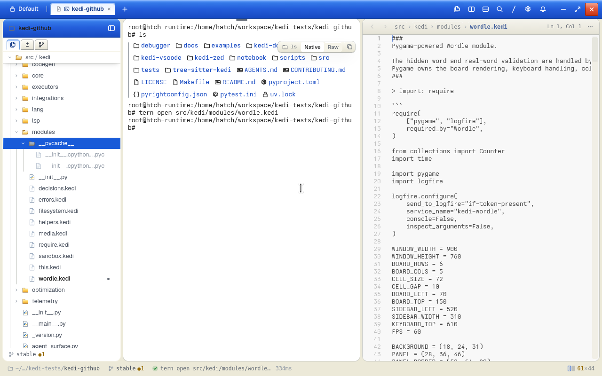
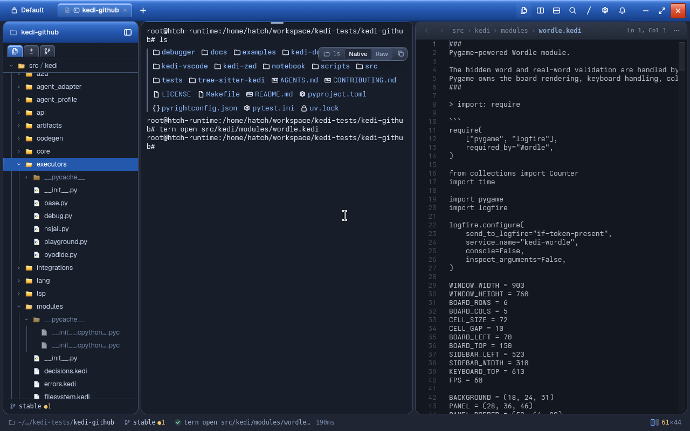
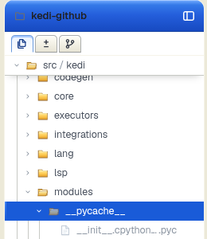
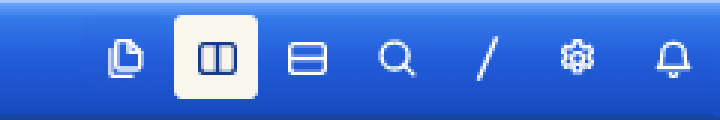
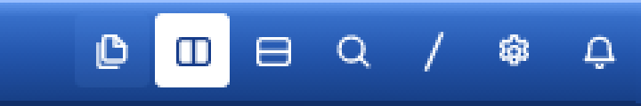

# tern-luna-xp

Windows XP Luna-inspired themes for [Tern](https://docs.stencil.so/tern/) (verified on Tern v0.9.30).

- `tern-luna-xp.css` — Luna XP Blue, light (v0.2.6)
- `tern-luna-xp-dark.css` — Luna XP Dark, midnight-blue steel (v0.3.6)

## Screenshots

Light — the Kedi repo open, `wordle.kedi` in the editor:



Dark — same workspace:



Files pane, light — selected folder stays blue with white text, even when
focus moves to the editor:



Title-bar hover, light (cream pill, dark blue icon) and dark (white pill,
dark blue icon):




## Install

Copy both files to Tern's themes folder, then pick them in Tern's Theme
picker, or set them in `settings.json`:

| OS | Themes folder |
| --- | --- |
| Linux | `~/.config/tern/themes/` |
| macOS | `~/Library/Application Support/tern/themes/` |

```json
{
  "theme_light": "tern-luna-xp",
  "theme_dark": "tern-luna-xp-dark",
  "status_bar": true
}
```

`status_bar` turns on the bottom status line (cwd + git branch), which the
theme styles beige like an XP IDE status bar (light) / dark steel (dark).
The theme filename without the extension is the theme name.

## What it styles

- **Tab strip:** glossy Luna-blue gradient, white text, XP-red close button,
  white window-control icons.
- **Files pane:** Explorer-blue header, classic XP folder/file icons, blue
  selected rows with white labels — in every state. (Tern paints the
  selection background on the row's `::before`, grey when the pane loses
  focus, so the theme overrides that too; a selected row never turns grey.)
- **Title-bar icons:** Tern slides a pill behind the hovered tool button;
  the theme paints the hovered icon dark blue so it stays readable — cream
  pill in light, white pill in dark.
- **Editor bar:** beige (light) / graphite (dark) with a bold blue filename.
- **Status line:** beige XP-IDE style (light) / dark steel (dark).
- **Restart-to-update pill:** solid white pill with dark blue text — Tern's
  own version is a ~10% accent wash and nearly unreadable on the blue strip.

A CSS theme cannot paint the OS desktop, taskbar or a menu bar — Tern has
none of those — so the resemblance stops at the window itself.

## Notes

- Tern's headless `tern shot` / `tern serve` runs do not load user themes;
  the themes only show in a real Tern window.
- All user-theme declarations are treated as `!important` by Tern, so among
  competing rules specificity + file order decide — the theme uses
  `#panel`-anchored selectors where it has to outrank Tern's own state rules.
